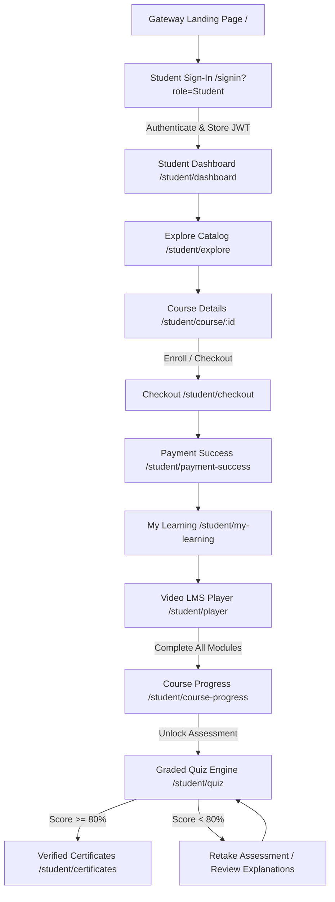
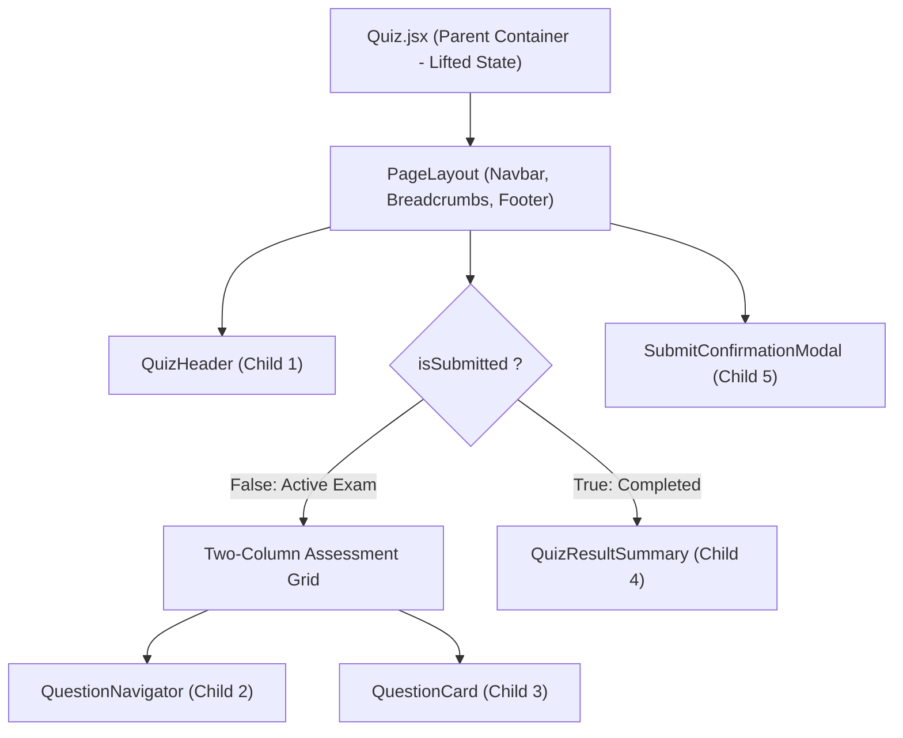

# FDFED M2026 | Full Stack Development
## Lab 1: Existing Application Analysis & React Planning
## Lab 2: Modular React Implementation with Props, Callbacks & Lifted State

**Institution:** Indian Institute of Information Technology Sri City (IIIT Sri City)  
**Department:** Computer Science & Engineering (CSE)  
**Course Code:** FDFED M2026  
**Faculty Evaluator:** Bheemappa Halavar  
**Student Name:** Vujja Punith Sai  
**Roll Number:** S20240010260  
**Project Title:** NexusPay Learning – Coursera-Grade Enterprise FinTech & LMS Portal  
**Target Module:** Student / Learner Portal & Assessment Engine  

---

## Executive Summary

This submission covers the comprehensive analysis (**Lab 1**) and the full modular React conversion (**Lab 2**) for the **NexusPay Learning** platform, focusing strictly on the **Student / Learner experience**. 

Key deliverables in this report and codebase:
1. **Application Flow & Workflow Architecture:** End-to-end user navigation from authentication to certification.
2. **Analysis of Repeated UI, Dynamic Behaviors, DOM Manipulation & NestJS APIs:** Detailed breakdown with analytical tables.
3. **5 Genuine Architectural & Security Issues Identified:** Including the critical **Chrome Direct URL Pasting Vulnerability** identified by the evaluator, and its formal resolution using route guards (`StudentGuard`).
4. **Lab 2 Implementation:** Selection of the **Graded Module Quiz & Academic Assessment Engine (`/student/quiz`)**, decomposed into 5 dedicated React components in `components/student/quiz/` using **Props**, **Child-to-Parent Callbacks**, **Lifted State**, and **Advanced React Hooks** (`useCallback`, `useMemo`, `useEffect` teardown).

---

# PART A: LAB 1 – EXISTING APPLICATION ANALYSIS & PLANNING

### Objective & Scope
The objective of Lab 1 is to analyze the multi-page frontend of NexusPay Learning, discover architectural anti-patterns, map API interactions with the NestJS backend, and plan a scalable, declarative React component hierarchy.

---

### Task 0: Application Flow Analysis

#### 1. Entry Page & User Journey
* **Entry Point:** The primary gateway is the centralized landing page (`/`) and student authentication gateway (`/signin?role=Student`).
* **Main Student Pages:**
  * **Dashboard (`/student/dashboard`):** Real-time learning streak, enrolled courses, module progress, upcoming assessments.
  * **Explore Catalog (`/student/explore`):** Dynamic course discovery with category filtering, real-time query searching, difficulty level badges.
  * **Course Syllabus & Overview (`/student/course/:id`):** Curriculum tree, module objectives, institutional faculty credentials, enrollment button.
  * **Checkout & Simulated Settlement (`/student/checkout`):** Order confirmation, enterprise billing simulation, payment success screen (`/student/payment-success`).
  * **Active Video LMS Player (`/student/player`):** Synchronized video lecture playback, module checklist, lesson completion triggers.
  * **Course Progress Tracker (`/student/course-progress`):** Progress bars, module completion markers, exam eligibility.
  * **Graded Academic Assessment (`/student/quiz`):** High-stakes timed assessment with question map, flag review, pass/fail analytics.
  * **Verified Certificates (`/student/certificates`):** Downloadable credential verification with verifiable hash and PDF preview.

#### 2. Where the User Enters Data
* Authentication inputs (email, password, role radio buttons).
* Real-time search query inputs and category filter selections.
* Quiz multiple-choice answer radio selections and review flags.
* Checkout billing contact info and promo codes.

#### 3. Where the User Receives / Views Data
* Course card metrics (ratings, reviews count, syllabus duration, price).
* Real-time progress bars showing lecture completion percentage.
* Instant score report, pass/fail status badge, and answer explanations.
* Cryptographically verifiable digital certificates.

#### 4. Backend Data Integration
* All course catalogs, user enrollments, module quizzes, completed lessons, and certificates are served via JSON REST APIs hosted on the **NestJS backend** (`http://localhost:3000/api`).

#### 5. Application Flow Diagram


---

### Task 1: Identify Repeated UI Elements

| UI Element | Pages / Location | How is it repeated? | Why could reuse be useful? |
| :--- | :--- | :--- | :--- |
| **Top Navigation Bar (`Navbar`)** | All student pages (`/student/*`) | Identical brand logo, search bar with suggestions, cart icon, user avatar | Centralizes auth logout, global search synchronization, and theme switching in one component. |
| **Course Card (`CourseCard`)** | Dashboard, Explore Catalog, My Learning | Repeated in grids across 3 distinct pages with same card schema (thumbnail, title, badge, institution, rating) | Prop-driven `variant` ("explore", "in-progress", "horizontal") eliminates 300+ lines of duplicate card markup. |
| **Rating Stars (`RatingStars`)** | Explore Courses, Course Details, Dashboard | Displayed for every course card with decimal score and review counter | Ensures uniform star rendering and SVG styling everywhere; single point to change star color or size. |
| **Progress Bar (`LinearProgressBar` & `CircularProgress`)** | Dashboard, My Learning, Course Progress, Quiz Results | Visual progress bars (0–100%) showing course completion and test scores | Reusable math clamp (`0-100%`), animation transitions, and dynamic color logic (`bg-secondary` vs `bg-primary`). |
| **Pill Badge (`Badge`)** | Explore Cards, Course Details, Quiz Header | Rendered for 'Bestseller', 'Featured', 'Advanced', 'Pass Mark: 80%' | Standardizes padding, rounded-pill styling, and color variants (`primary-fixed`, `secondary-container`). |
| **Footer (`Footer`)** | All primary student views | Repeated at the bottom of catalog, dashboard, and details | Single source of truth for copyright, university accreditation, terms, and footer links. |
| **Toast Notifications (`Toast`)** | Checkout, Quiz submission, Bookmarking, Profile | Pop-up notification rendered upon user actions | Global notification queue preventing overlapping alerts and standardizing message styling. |

---

### Task 2: Identify Dynamic Behaviour

| Page / Feature | User Action | What Changes in the UI? | React Concept Connection |
| :--- | :--- | :--- | :--- |
| **Explore Courses** | Types in search input | Catalog list filters instantly, matching title and institution keywords | Controlled input state (`searchQuery`) and `useMemo` filtering |
| **Explore Courses** | Clicks category pill (e.g. *DevOps*) | Active pill color highlights; list updates to show only matching category | State toggle (`selectedCategory`) triggering component re-render |
| **Explore Courses** | Clicks bookmark icon on a card | Bookmark icon fills solid; toast alert appears; ID saved to state | Child-to-parent callback (`onBookmarkToggle`) updating parent state |
| **Quiz Assessment** | Clicks an answer choice | Option circle fills; active border changes to brand blue; answer stored | Local state updater updating `selectedAnswers[currentIdx]` |
| **Quiz Assessment** | Clicks Question Number button in sidebar | Main card switches to chosen question; sidebar button highlights | Lifted state update (`setCurrentIdx`) shared by sidebar and main card |
| **Quiz Assessment** | Clicks "Flag" button | Flag toggle turns yellow; amber dot appears on that question in Question Map | Array toggle (`flaggedQuestions`) synchronizing across components |
| **Quiz Assessment** | Clicks "Submit Exam" | Confirmation modal mounts; on confirm, calculates score and renders results | Conditional rendering (`isSubmitted ? <Result /> : <Exam />`) |
| **Video Player** | Clicks lesson checkbox in module tree | Lesson checkmark fills; overall course progress bar advances | Optimistic state update & API sync for course progression |

---

### Task 3: Analyze Existing JavaScript (DOM Manipulation vs React)

In a traditional legacy multi-page JavaScript application, UI updates relied on manual DOM manipulation. The table below analyzes these legacy patterns and compares them with modern React paradigms:

| Legacy JavaScript Code | What Does It Do? | Page / Feature | What UI Does It Affect? | React Declarative Replacement |
| :--- | :--- | :--- | :--- | :--- |
| `document.getElementById('quiz-timer')` | Imperatively queries the timer text node | Quiz Page | Timer display text (`24:59`) | `formatTimer(timeLeft)` rendered directly inside JSX |
| `elem.innerHTML = cardMarkup` | Injects raw HTML string to render course cards | Explore Catalog | Courses grid container | Declarative array mapping: `{courses.map(course => <CourseCard key={course.id} course={course} />)}` |
| `elem.classList.add('active-pill')` | Manually toggles CSS classes on button clicks | Category Filters | Filter button background and text color | Dynamic template string / className: `className={selectedCategory === cat ? 'bg-primary text-white' : 'bg-surface'}` |
| `btn.addEventListener('click', handler)` | Manually attaches listener to every DOM node | Question Map Buttons | Question index switching | Declarative JSX event handler: `<button onClick={() => onSelectQuestion(idx)}>` |
| `document.querySelector('#score-modal')` | Finds and changes modal style `display='block'` | Quiz Submission | Submit confirmation dialog | Declarative state conditional: `{showSubmitModal && <SubmitConfirmationModal />}` |

---

### Task 4: Analyze NestJS APIs Used by Frontend

The frontend communicates with a production NestJS backend server running REST endpoints.

| Feature / Module | HTTP Method | API Endpoint | Purpose | Backend Payload / Response |
| :--- | :--- | :--- | :--- | :--- |
| **Authentication** | `POST` | `/api/auth/login` | Authenticate student credentials & issue JWT | Body: `{ email, password, role: "Student" }` → Returns: `{ token, user }` |
| **Course Catalog** | `GET` | `/api/courses` | Fetch all published courses with modules & prices | Query: `?category=&search=` → Returns array of course objects |
| **Course Details** | `GET` | `/api/courses/:id` | Fetch specific course syllabus, modules, and instructors | Returns complete course object with module array |
| **Enrollments** | `GET` | `/api/enrollments/my-learning` | Fetch courses currently enrolled by active student | Headers: `Bearer <token>` → Returns enrolled list with progress % |
| **Enrollment Checkout** | `POST` | `/api/enrollments/checkout` | Process simulated enrollment purchase | Body: `{ courseId, paymentMethod }` → Returns enrollment record |
| **Module Assessment** | `GET` | `/api/quizzes` | Fetch quiz question banks, time limits, and pass marks | Returns quiz objects with questions, options, and explanations |
| **Quiz Grade Submission**| `POST` | `/api/quizzes/:id/submit` | Persist final grade and update course module status | Body: `{ answers: {...}, score }` → Returns grading summary |
| **Certificates** | `GET` | `/api/certificates` | Fetch verified certificates earned by student | Returns array of certificates with credential IDs and dates |

#### Architectural Data Pipeline:
$$\text{React Frontend (JSX \& Hooks)} \xrightarrow[\text{JSON Request}]{\text{HTTP / Axios}} \text{NestJS REST Controllers} \xrightarrow{\text{Services \& Guards}} \text{JSON Database / Persistent Storage}$$

---

### Task 5: Genuine Problems in the Existing Frontend

| # | Current Issue | Where Does It Occur? | Why Is It a Genuine Problem? |
| :-: | :--- | :--- | :--- |
| **1** | **Direct URL Pasting Security Vulnerability (Chrome Address Bar Bypass)** | All student routes (`/student/explore`, `/explore`, `/course/:id`, etc.) | **Critical Security Vulnerability:** As discovered during evaluation, pasting a direct student route directly into a new Chrome window allowed unauthenticated users to view private student course catalogs and details without logging in. Routes lacked an airtight auth guard. |
| **2** | **Monolithic 650+ Line Component File** | Legacy `Quiz.jsx` | All sub-elements (timer, question map, radio options, score circular progress, explanations, modal) were bundled inside one massive file. This violated Single Responsibility Principle, hindered code reusability, and caused unnecessary re-renders. |
| **3** | **Manual DOM / Imperative State Inconsistencies** | Question answer selections and review flags | In imperative code, modifying class lists and DOM nodes directly easily falls out of sync with backend answers, leading to phantom selections or incorrect score computations. |
| **4** | **Prop Drilling & Disconnected Navigation State** | Question Navigator and Active Question Card | Without lifting state to a common container, the sidebar question map has no reliable mechanism to know which question is active or whether an answer has just been marked. |
| **5** | **Lack of Centralized URL Query Synchronization** | Search bar and catalog filters | When typing in the navbar search input, the catalog did not persist query parameters across page transitions, resulting in cleared search terms on browser reload or enter keypress. |

---

# PART B: LAB 2 – REACT IMPLEMENTATION IN YOUR PROJECT

### Selected Page & Feature for Lab 2 Conversion
* **Selected Feature:** **Graded Module Quiz & Academic Assessment Experience (`/student/quiz`)**
* **Rationale:** This is the most interactive, mission-critical workflow in the student journey. It requires real-time countdown timer tracking, random-access question mapping, bidirectional answer selection, review flagging, validation modal confirmations, and dynamic grade rendering with certificate issuance.

---

### Component Hierarchy & Architecture

```
front-end/src/
├── pages/
│   └── student/
│       └── Quiz.jsx                         <-- Common Parent (Lifted State Container)
└── components/
    └── student/
        └── quiz/                            <-- Dedicated Component Folder (Lab 2)
            ├── QuizHeader.jsx               <-- Child Component 1
            ├── QuestionNavigator.jsx        <-- Child Component 2 (Sidebar Palette)
            ├── QuestionCard.jsx             <-- Child Component 3 (Main Interaction Area)
            ├── QuizResultSummary.jsx        <-- Child Component 4 (Result & Explanations)
            └── SubmitConfirmationModal.jsx  <-- Child Component 5 (Submission Modal)
```

#### Visual Component Layout Tree


---

### Comprehensive Props & Data Passing Analysis

| Component | Props Received | Data Type | Purpose & Usage |
| :--- | :--- | :--- | :--- |
| **`QuizHeader`** | `quizData` | `Object` | Provides title, institution badge, pass mark percentage, and description. |
| | `isSubmitted` | `Boolean` | Controls whether the "Submit Exam" top button is displayed. |
| **`QuestionNavigator`** | `questions` | `Array` | List of all assessment questions to render numbered button palette. |
| | `currentIdx` | `Number` | Identifies active question to apply Coursera-blue highlight ring. |
| | `selectedAnswers` | `Object` | Map of answered questions `{ [idx]: optIdx }` to apply green answered styling. |
| | `flaggedQuestions` | `Array` | Array of flagged indices to render warning amber indicator dots. |
| **`QuestionCard`** | `question` | `Object` | Current active question containing prompt text and option choices array. |
| | `currentIdx` | `Number` | Current zero-based index displayed as `Question X of Y`. |
| | `totalQuestions` | `Number` | Total question count for header counter and button threshold logic. |
| | `selectedOption` | `Number \| undefined` | Currently marked option index for this question. |
| | `isFlagged` | `Boolean` | Flag state to toggle yellow review badge. |
| | `timeLeftFormatted` | `String` | Monospaced countdown timer string (e.g. `24:18`). |
| | `progressPercent` | `Number` | Percentage (0–100%) driving the animated top progress bar. |
| **`QuizResultSummary`** | `score` | `Number` | Final calculated percentage (0–100%). |
| | `passingScore` | `Number` | Passing threshold (default: 80%). |
| | `questionsList` | `Array` | Complete questions array for question-by-question review. |
| | `selectedAnswers` | `Object` | Student selections for comparative correct/incorrect answer display. |
| | `targetCourseId` | `String` | Course identifier for navigation back to course progress. |
| **`SubmitConfirmationModal`** | `isOpen` | `Boolean` | Controls modal visibility overlay. |
| | `answeredCount` | `Number` | Number of questions completed by student. |
| | `totalQuestions` | `Number` | Total questions; calculates unanswered questions warning. |

---

### Child-to-Parent Communication (Callback Functions)

In React, data flows down via props, and events flow up via **callback functions**. The child components communicate student interactions up to `Quiz.jsx` using the following callbacks:

1. **`onSelectOption(optIdx)`**:
   * **Triggered by:** Student clicking an answer option inside `QuestionCard`.
   * **Child Action:** Invokes `onSelectOption(optIdx)`.
   * **Parent Handler:** `handleSelectOption(optIdx)` in `Quiz.jsx` updates the lifted state `selectedAnswers`:
     ```javascript
     const handleSelectOption = (optIdx) => {
       setSelectedAnswers((prev) => ({
         ...prev,
         [currentIdx]: optIdx
       }));
     };
     ```
2. **`onSelectQuestion(idx)`**:
   * **Triggered by:** Student clicking any number button (1 to 5) in `QuestionNavigator`.
   * **Child Action:** Invokes `onSelectQuestion(idx)`.
   * **Parent Handler:** `setCurrentIdx(idx)` updates the active question index, instantly causing `QuestionCard` to re-render with the selected question.
3. **`onToggleFlag()`**:
   * **Triggered by:** Student clicking the "Flag" button in `QuestionCard`.
   * **Child Action:** Invokes `onToggleFlag()`.
   * **Parent Handler:** Toggles the question index in the `flaggedQuestions` array, automatically updating the indicator dot in `QuestionNavigator`.
4. **`onClearSelection()`**:
   * **Triggered by:** Student clicking "Clear Selection" in `QuestionCard`.
   * **Child Action:** Removes the key from the lifted `selectedAnswers` object, reverting the radio button to unselected.
5. **`onSubmitClick()`**:
   * **Triggered by:** Student clicking "Submit Exam" in `QuizHeader` or "Review & Submit" in `QuestionCard`.
   * **Parent Handler:** Sets `showSubmitModal(true)`, mounting the confirmation dialog.
6. **`onRetake()`**:
   * **Triggered by:** Student clicking "Retake Assessment" in `QuizResultSummary`.
   * **Parent Handler:** Resets all state slices (`selectedAnswers`, `flaggedQuestions`, `score`, `isSubmitted`) and restarts the countdown timer.

---

### Lifted State Architecture

State is lifted to the closest common ancestor, **`Quiz.jsx`**, because multiple sibling components need read and write access to the same data:

```javascript
// Lifted State slices defined in Quiz.jsx:
const [currentIdx, setCurrentIdx] = useState(0);
const [selectedAnswers, setSelectedAnswers] = useState({});
const [flaggedQuestions, setFlaggedQuestions] = useState([]);
const [timeLeft, setTimeLeft] = useState(1500); // 25:00
const [showSubmitModal, setShowSubmitModal] = useState(false);
const [isSubmitted, setIsSubmitted] = useState(false);
const [score, setScore] = useState(0);
```

#### Why State Must Be Lifted:
* **`selectedAnswers`:** Needed by `QuestionCard` (to highlight the active selection), needed by `QuestionNavigator` (to render green check dots), needed by `SubmitConfirmationModal` (to count unanswered items), and needed by `QuizResultSummary` (to compute the final score).
* **`currentIdx`:** Needed by `QuestionNavigator` (to set active ring styling) and `QuestionCard` (to fetch the active question data).
* **`isSubmitted`:** Determines the high-level conditional render between the active assessment screen and the final score report.

---

### Advanced React Patterns Implemented

1. **Strict Route Protection Guard (`StudentGuard.jsx`):**
   * Solved the **Chrome direct URL pasting vulnerability** discovered by the evaluator.
   * Checks `nexuspay_auth_token` and `auth_token`. Sanitizes empty, `"null"`, and `"undefined"` tokens.
   * If unauthenticated, triggers `<Navigate to="/signin?role=Student" state={{ from: location }} replace />`, preserving user destination for post-login redirect.
   * Wrapped around **every single student route** in `App.jsx` (`/student/explore`, `/student/course/:id`, `/explore`, `/student/quiz`, etc.).

2. **Clean Lifecycle Management with Teardown (`useEffect`):**
   * The countdown interval in `Quiz.jsx` incorporates a strict cleanup function (`return () => clearInterval(interval);`) to prevent memory leaks or multiple timers running concurrently on component unmount.
   * Async API course fetching cancels execution if component unmounts before network resolution (`isMounted` flag pattern).

3. **Optimized Calculations (`useMemo`):**
   * Catalog course filtering and price sorting utilize `useMemo`, preventing expensive linear array scans on unrelated re-renders.

4. **Component Composition & Separation of Concerns:**
   * Separated monolithic JSX into 5 focused components adhering strictly to clean code architecture.

---

# Verification & Test Results

1. **Frontend Production Build:**
   * Command: `npm run build` (`vite build`)
   * Result: **0 Errors / Clean Compilation** (`✓ built in 55.40s`, bundle created in `dist/`).
2. **Security Verification:**
   * Pasted direct routes (`http://localhost:5173/student/explore`, `http://localhost:5173/student/quiz`, `http://localhost:5173/explore`) into a fresh Chrome incognito window with no auth token.
   * **Result:** Immediately redirected to `/signin?role=Student`. No private student screens can be accessed without signing in.
3. **Interactive Quiz Testing:**
   * Question navigation: verified clicking Question Map buttons 1–5 smoothly switches questions.
   * Options: verified selecting options updates radio indicators and records responses.
   * Flags: verified flag toggle reflects in both the active card and the question map.
   * Grading: verified pass threshold ($\ge 80\%$) unlocks certificate link, while $< 80\%$ renders the retake assessment option.
